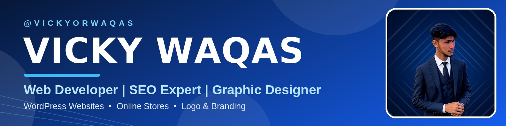

  

<h1 align="center">Hi there, I'm Waqas 👋 — VickyOrWaqas</h1>

  

  

  
  
  
  

---

## 🚀 About Me

- 💻 I build **websites that bring customers** — business websites, WordPress websites and online stores
- 🔍 I help businesses **rank higher on Google** with SEO, Local SEO and Google Business Profile optimization
- 🎨 I design **logos, banners and social media posts** that make brands look professional
- 🌐 Working online with clients across Pakistan and worldwide
- ✨ Open to **freelance projects** and remote work

## 🛠️ What I Do

| 🌐 Web Development | 🔍 SEO | 🎨 Graphic Design |
| --- | --- | --- |
| Business Websites | Google Ranking | Logo Design |
| WordPress Websites | Local SEO | Social Media Design |
| Online Stores | Google Business Profile Setup | Banners & Branding |

## 💡 Skills & Tools

  
  
  
  
  

## 🤝 Why Work With Me

- ✅ Honest prices — no hidden charges
- ✅ Friendly, clear communication
- ✅ Clean, quality work delivered on time
- ✅ Support even after the project is done

## 📬 Let's Work Together

Have a project in mind? Message me on **LinkedIn**, **Facebook** or **Instagram** (@vickyorwaqas), or email me at **vickyorwaqas@gmail.com** — I usually reply the same day.

  

